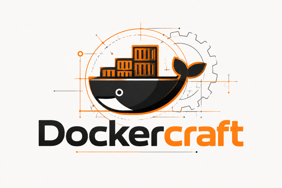

# Dockercraft

Dockercraft is a FastAPI web application for reviewing and improving Dockerfiles. It analyzes Dockerfile instructions, reports common issues, generates a heuristically optimized version, and provides a small web UI for comparing the input and output.

> Optimization and size figures are recommendations and estimates only. Dockercraft does not build Docker images or measure their actual size, security, or runtime behavior. Review generated changes before using them.

  

[screenshots](docs/screenshots/dockercraft.png)


## Features

- Analyze a Dockerfile by pasting text or uploading a file.
- Report base image/tag, instruction counts, and audit findings.
- Check eight areas: root-user declarations, `ADD`, downloads in `RUN`, APT cleanup, excessive `RUN` layers, `VOLUME`, possible secrets in `ENV`, and floating `:latest` tags.
- Generate an optimized Dockerfile with best-effort changes such as combining related `RUN` instructions, adding package-manager flags/cleanup, replacing eligible `ADD` with `COPY`, pinning some common base images, and adding `USER`/`WORKDIR` suggestions.
- Optionally include recommended `.dockerignore` content in the generated output or download it separately.
- Show a multi-stage build suggestion for some build-heavy Dockerfiles.
- Compare two Dockerfiles with instruction-level and textual diffs. This does not build or inspect images.
- Load unoptimized example Dockerfiles for Node.js, Python, Go, and Rust from the UI.
- Provide audit-rule information, privacy, health, robots, and sitemap pages.
- Syntax highlighting and copy-to-clipboard.

## Technology and architecture

- **Backend:** Python, FastAPI, Pydantic, Uvicorn.
- **Templates/UI:** Jinja2 templates, vanilla JavaScript, CSS, and static assets under `app/static/`.
- **Dockerfile parsing:** `dockerfile-parse` is used when available; the analyzer has internal/fallback parsing logic as well.
- **Tests:** pytest and FastAPI `TestClient`.

### Repository layout

```text
app/
  main.py                 FastAPI app, HTML pages, static mount, health/SEO endpoints
  routes/analyzer.py      Analyze, optimize, diff, and dockerignore endpoints
  services/analyzer.py    Dockerfile parsing, metrics, findings, multi-stage suggestions
  services/generator.py   Heuristic optimized Dockerfile and .dockerignore generation
  services/parser.py      Internal Dockerfile parser/fallback
  services/rules.py       Eight audit-rule checks
  templates/              Jinja2 pages, shared layout, and header
  static/                 CSS, JS, favicon, and Node/Python/Go Dockerfile examples
core/config.py             Legacy configuration module; current app settings are in app/main.py
requirements.txt           Python dependencies
.env.example               Example supported application settings
Dockerfile                 Container image definition
.dockerignore              Excludes local secrets and development files from image builds
docker-compose.yml         Optional Docker Compose example with Nginx
nginx.conf                 HTTP reverse-proxy example for Compose
tests/                      Unit and route tests
```

The `core/config.py` module and some older configuration files are not currently used by the main application. Runtime template settings are read in `app/main.py` from environment variables (and `.env`, if present).

## Web pages

| URL | Purpose |
| --- | --- |
| `/` | Dockerfile analyzer and optimizer UI |
| `/rules` | Description of the eight audit rules |
| `/privacy` | Privacy and data-use information |
| `/health` | JSON health response |
| `/robots.txt` | Search-engine crawler instructions |
| `/sitemap.xml` | Sitemap for the public pages |

Highlight.js core and the Chalk theme are served locally; the Dockerfile language grammar is fetched from cdnjs.

## API access

Public site requests are limited to `GET`. The `/api` routes are internal endpoints used by the first-party web interface, not a supported public API; calls without same-origin browser metadata or with a different `Origin` are rejected. Same-origin API requests, including the `POST` requests needed by the analyzer UI, remain enabled. FastAPI's OpenAPI schema and interactive API documentation are disabled.

These request checks prevent ordinary cross-origin website use; they are not authentication and can be spoofed by a determined direct HTTP client. Do not treat them as an authorization boundary for sensitive operations.

## Configuration

Copy `.env.example` to `.env` and set only the values you need. `.env` is ignored by Git and must not be committed.

| Variable | Default | Purpose |
| --- | --- | --- |
| `APP_ENV` | unset (legacy single `.env`) | Optional `TEST` or `PROD` profile selector; loads `.env.test` or `.env.prod` |
| `SITE_TITLE` | `dockercraft` | Site name used in templates |
| `SITE_DESCRIPTION` | Built-in description | SEO description |
| `FRONTEND_URL` | empty | Production HTTPS origin, e.g. `https://example.com`; used for the API same-origin allowlist and sitemap |

### Optional TEST/PROD profiles

For backward compatibility, if `APP_ENV` is unset, the app loads the usual single `.env` file. To select a separate profile, create complete `.env.test` and/or `.env.prod` files (for example, copy `.env.example` and customize each one), then make `.env` contain only the selector:

```dotenv
APP_ENV=TEST
```

`APP_ENV=TEST` loads only `.env.test`; `APP_ENV=PROD` loads only `.env.prod`. Profile files are ignored by Git. An invalid mode or missing selected file stops startup rather than falling back to another environment. Variables supplied by systemd/the process environment take precedence over profile values. After changing the selector or a profile, restart the application. On an existing deployment, preserve the current `.env` as the appropriate profile before replacing it with the selector file.

Keep test and production settings isolated in separate profile files. A single running process uses one profile; concurrent TEST and PROD instances need separate service configurations and ports.

The application processes submitted Dockerfile text to produce a response and does not retain the text or results between requests.

## Run locally

Requirements: Python 3.10+ (the supplied Dockerfile uses Python 3.13), `venv`, and Git.

```bash
# Clone the repository from its configured Git remote.
cd dockercraft

cp .env.example .env
python3 -m venv .venv
.venv/bin/python -m pip install --upgrade pip
.venv/bin/python -m pip install -r requirements.txt

# Development server with auto-reload
.venv/bin/python -m uvicorn app.main:app --reload --host 127.0.0.1 --port 8000
```

Open <http://127.0.0.1:8000>. To make the development server reachable from other machines, change the host to `0.0.0.0` and allow port 8000 through the relevant firewall.

## Tests

Tests run on the maintained test server (tests and builds for this project are not run on developer workstations). Set `TEST_SERVER_SSH_KEY_PATH`, `TEST_SERVER_USER`, and `TEST_SERVER_HOST` to the SSH key path and server connection details:

```bash
ssh -i "$TEST_SERVER_SSH_KEY_PATH" "$TEST_SERVER_USER@$TEST_SERVER_HOST" \
  "cd ~/dockercraft && .venv/bin/python -m pytest -q"
```

Run an individual test module remotely:

```bash
ssh -i "$TEST_SERVER_SSH_KEY_PATH" "$TEST_SERVER_USER@$TEST_SERVER_HOST" \
  "cd ~/dockercraft && .venv/bin/python -m pytest tests/test_analyzer.py -q"
```

## Production-style Uvicorn run

For deployment behind a reverse proxy, bind Uvicorn to loopback and run one worker:

```bash
cd ~/dockercraft
.venv/bin/python -m uvicorn app.main:app --host 127.0.0.1 --port 8000 --workers 1
```

The application handles each request independently and requires no server-side data store. Choose worker count based on available CPU/RAM and verify with a load test.

Check the service locally:

```bash
curl -fsS http://127.0.0.1:8000/health
# Expected: {"status":"ok","version":"0.2.0"}
```

## Install a user-level systemd service

Run the service as the account that owns the project directory and user-level systemd unit.

1. Clone the repository and install dependencies using the local setup steps above.
2. Create `~/.config/systemd/user/dockercraft.service`:

```ini
[Unit]
Description=Dockercraft FastAPI service
Wants=network-online.target
After=network-online.target

[Service]
Type=simple
WorkingDirectory=%h/dockercraft
Environment=PYTHONUNBUFFERED=1
ExecStart=%h/dockercraft/.venv/bin/python -m uvicorn app.main:app --host 127.0.0.1 --port 8000 --workers 1
Restart=on-failure
RestartSec=5

[Install]
WantedBy=default.target
```

Create the unit file without an interactive editor:

```bash
mkdir -p ~/.config/systemd/user
cat > ~/.config/systemd/user/dockercraft.service <<'EOF'
[Unit]
Description=Dockercraft FastAPI service
Wants=network-online.target
After=network-online.target

[Service]
Type=simple
WorkingDirectory=%h/dockercraft
Environment=PYTHONUNBUFFERED=1
ExecStart=%h/dockercraft/.venv/bin/python -m uvicorn app.main:app --host 127.0.0.1 --port 8000 --workers 1
Restart=on-failure
RestartSec=5

[Install]
WantedBy=default.target
EOF

systemctl --user daemon-reload
systemctl --user enable --now dockercraft.service
systemctl --user status dockercraft.service --no-pager -l
```

A user service may stop when the user logs out unless lingering is enabled. On a system where you have sudo access, enable it with:

```bash
sudo loginctl enable-linger "$USER"
```

Useful service commands:

```bash
systemctl --user start dockercraft.service
systemctl --user stop dockercraft.service
systemctl --user restart dockercraft.service
systemctl --user status dockercraft.service --no-pager -l
journalctl --user -u dockercraft.service -f
```

Deploy a code update on the server:

```bash
cd ~/dockercraft
git pull --ff-only origin main
.venv/bin/python -m pip install -r requirements.txt
systemctl --user restart dockercraft.service
systemctl --user status dockercraft.service --no-pager -l
curl -fsS http://127.0.0.1:8000/health
```

### Automated test deployment with Forgejo Actions

`.forgejo/workflows/deploy-test.yml` runs when a commit is pushed to `main` (and can also be started manually with `workflow_dispatch`). The runner connects to the test server over SSH; the server fast-forward pulls `origin/main`, updates the virtual environment, runs the tests, restarts the user-level service, and checks `/health`. The runner needs the `ubuntu-latest` label and network access to the test server.

Add these repository Actions secrets in Forgejo:

- `TEST_SERVER_HOST` — test server address reachable from the runner.
- `TEST_SERVER_USER` — SSH account that owns `~/dockercraft` and the user-level systemd service.
- `TEST_SERVER_SSH_KEY` — private key whose public key is in that account's `authorized_keys`.
- `TEST_SERVER_KNOWN_HOSTS` — verified SSH host-key line for the server; do not disable host-key checking.

The server's own Git SSH key must also be able to read the Forgejo repository. Deployment uses `git pull --ff-only` and never runs `git reset` or `git clean`; server-local files such as `.env` are preserved. If an uncommitted server change conflicts with an incoming commit, the workflow fails instead of overwriting it. If the runner uses a label other than `ubuntu-latest`, update `runs-on` in the workflow.

The `.env` file is loaded from the service working directory by `python-dotenv`. Keep `.env` out of Git and restrict its filesystem permissions when it contains private configuration.

## Docker

Build and run the application container directly:

```bash
cp .env.example .env
docker build -t dockercraft:local .
docker run --rm --name dockercraft \
  --env-file .env \
  -p 8000:8000 \
  dockercraft:local
```

Then check `http://127.0.0.1:8000/health`.

The repository also includes a basic Nginx + Docker Compose setup. It serves HTTP only; configure TLS at a trusted reverse proxy/load balancer before exposing a production site to the public internet.

```bash
cp .env.example .env
docker compose config
docker compose up -d --build
docker compose ps
docker compose logs -f app
docker compose logs -f nginx
```

Stop the Compose stack:

```bash
docker compose down
```

## Production notes and limitations

- The application does not retain submitted Dockerfile text or analysis results after returning a response. Deployment infrastructure may maintain separate access logs and retention settings.
- Put Uvicorn behind an HTTPS reverse proxy, configure the production hostname and certificates, and restrict direct access to port 8000.
- The analyzer is heuristic and is not a complete Dockerfile validator or security scanner. It does not build images, inspect layers, or verify that generated Dockerfiles build successfully.
- Estimated size and savings are approximate calculations from Dockerfile text and detected changes, not measurements of image size.
- The eight audit rules are documented at `/rules`; some are recommendations and may not apply to every project.

## Contributing

1. Create a focused branch/change.
2. Add or update tests for behavior changes.
3. Run `.venv/bin/python -m pytest -q` on the test server.
4. Review generated Dockerfiles manually; the optimizer is best-effort.

## License

MIT. See [LICENSE](LICENSE).
